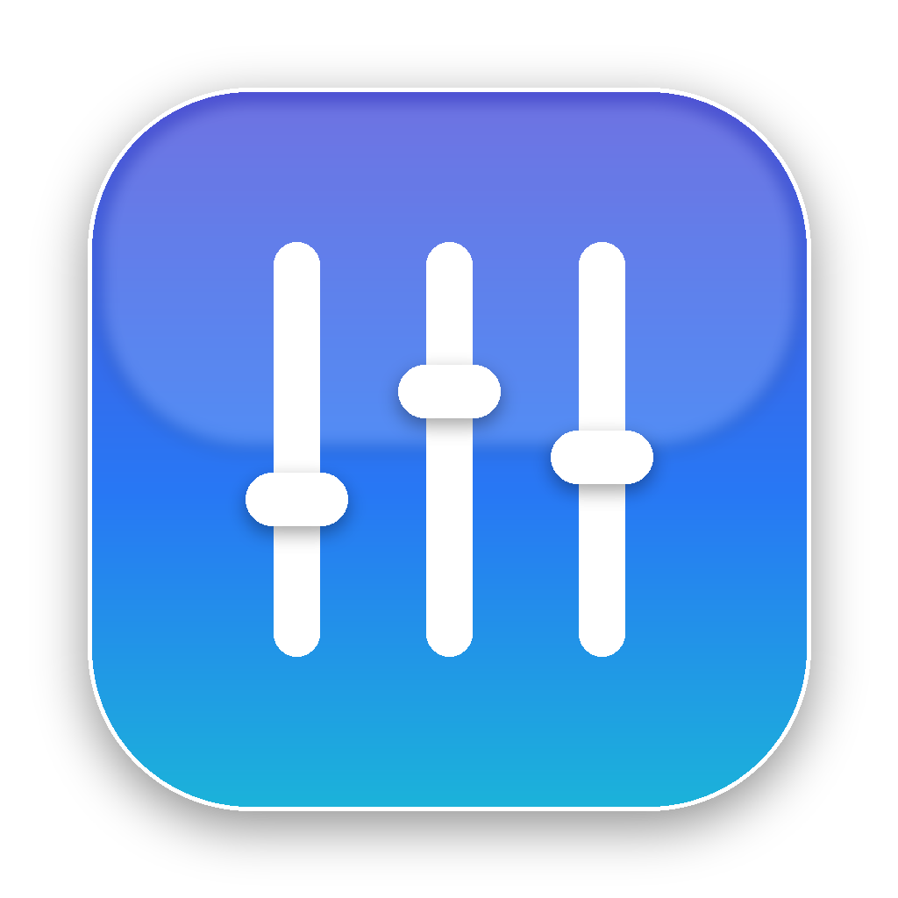

<p align="center">
  
</p>

<h1 align="center">SourceMix</h1>

<p align="center">A tiny, native per-app volume mixer for macOS — with a 15-band EQ and left/right routing for every source.</p>

---

SourceMix lives in your menu bar. Every app that's making sound gets its own vertical fader with a live waveform, a mute button, an output-channel picker and its own equalizer. It's written in SwiftUI and uses Core Audio **process taps**, so there's no kernel extension or virtual audio driver to install.

## Features

- **Every audio source, independently** — Music, Safari, Zoom, Chrome, games, system sounds… each appears automatically while it plays (helper processes are grouped under their app).
- **Vertical faders with live waveforms** — the light-grey track carries a slightly darker, scrolling waveform of that source. 100 % (the app's original level) sits three-quarters of the way up; the top quarter adds up to +9 dB of boost with a soft limiter.
- **Mute** any stream, or the whole output.
- **15-band graphic EQ per source** (25 Hz – 16 kHz, ±12 dB, ISO ⅔-octave bands) with a live response curve and presets (Bass Boost, Vocal, Speech, Loudness, Night Mode…).
- **Per-stream channel routing** — Stereo, Left ear only, Right ear only, or Mono. Put a podcast in one ear and a call in the other.
- **Menu bar mixer** — the equalizer icon opens a compact mixer for quick level and mute changes, with a button to open the full window.
- **Runs in the background** — no Dock icon until you open a window; settings are remembered per app; optional Launch at Login.
- **Liquid Glass design** on macOS 26 Tahoe (`glassEffect`, `GlassEffectContainer`, glass buttons), with a material fallback on macOS 15. System fonts and SF Symbols throughout.

## Requirements

- macOS 15 Sequoia or later (macOS 26 Tahoe for Liquid Glass)
- Xcode 26 / Swift 6 toolchain to build

## Build & run

```bash
git clone https://github.com/jeremykjackson/SourceMix.git
cd SourceMix
./scripts/build-app.sh --install   # builds, copies to /Applications, launches
```

Or open `Package.swift` in Xcode and press ⌘R.

On first launch macOS asks for **Audio Capture** permission (System Settings › Privacy & Security › Screen & System Audio Recording › *System Audio Recording Only*). SourceMix needs it to tap each app's audio; nothing ever leaves your Mac.

Pre-built, ad-hoc–signed builds are attached to each CI run under **Actions › Build › Artifacts**. Because they aren't notarized, right-click the app and choose **Open** the first time.

## How it works

```
App audio ──► Core Audio process tap (muted when tapped)
                     │
                     ▼
        private aggregate device (output device + tap)
                     │  IO callback
                     ▼
   StreamProcessor: 15× biquad EQ → gain/mute → L/R/Mono routing → soft clip
                     │
                     ▼
               your speakers / headphones
```

- `MixerStore` watches the HAL process list (`kAudioHardwarePropertyProcessObjectList`) and groups processes by their responsible app.
- Each source gets a `ProcessTap` (`CATapDescription` + `AudioHardwareCreateProcessTap`) feeding a private aggregate device on the current output. The original audio is silenced while tapped and the processed copy is played instead.
- `StreamProcessor` is real-time safe: parameters cross threads through atomics, EQ coefficients are double-buffered, and nothing allocates on the audio thread. It also records a peak history that the faders draw as the waveform.
- Switching output devices rebuilds the taps automatically. Quitting SourceMix releases every tap, so apps instantly go back to normal.
- Idle sources with default settings drop out of the list (and release their tap) after 20 seconds to keep CPU use near zero.

## Project layout

```
Sources/SourceMix
├── App/SourceMixApp.swift        Menu bar extra, windows, app delegate, login item
├── Audio/
│   ├── CoreAudioHelpers.swift    Typed HAL property access + listeners
│   ├── ProcessTap.swift          Process tap + aggregate device + IO callback
│   ├── StreamProcessor.swift     Real-time DSP: EQ, gain, routing, metering
│   └── SystemSupport.swift       Permission, app ownership, output device volume
├── Model/
│   ├── MixerStore.swift          Source discovery and state
│   └── SourceSettings.swift      Per-app settings, volume taper, EQ presets
└── UI/
    ├── Glass.swift               Liquid Glass helpers (with fallback)
    ├── VolumeSlider.swift        Vertical fader with waveform overlay
    ├── ChannelStrip.swift        Mixer strips
    ├── MixerView.swift           Main window
    ├── EqualizerView.swift       15-band EQ page
    └── MenuBarView.swift         Menu bar panel
```

## Known limitations

- The **Output** strip controls the device's hardware volume; per-source EQ is applied to apps, not to the whole output.
- Apps that bypass the Core Audio HAL (rare) can't be tapped.
- Taps add one IO buffer of latency (typically ~5–10 ms) to the apps being processed.

## License

MIT — see [LICENSE](LICENSE).
